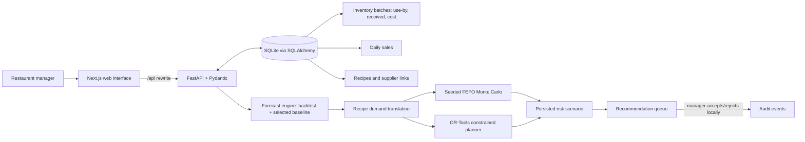

# Architecture overview

GhostWaste is a local-first planning prototype. Its UI reads and writes only through a FastAPI service, which persists local records to SQLite through SQLAlchemy. Docker packaging is for local demonstration; it is not a deployment configuration.

## Data flow

1. A manager records inventory batches, daily menu sales, recipes, and explicitly linked supplier constraints.
2. A forecast run compares baseline candidates with rolling-origin, one-step-ahead evaluation. The selected model predicts menu servings.
3. Recipe quantities translate predicted servings into ingredient kilograms for the selected horizon.
4. The workflow snapshots current inventory, forecast-derived daily demand, and supplied constraints. It calculates deterministic FEFO expiry exposure; independently, it runs a seeded demand-uncertainty simulation.
5. The planner proposes quantities only for ingredients with an explicit supplier link and known price. It preserves unmet shortage when input data cannot support a purchase recommendation.
6. Inputs and outputs are persisted together as a risk scenario. Equal run ID, inputs, and seed restore the same scenario rather than creating a duplicate.
7. Recommendation records wait for an explicit final manager decision. A decision writes an audit event; it does not make a purchase, contact a supplier, or mutate stock.

## Engineering decisions and trade-offs

| Decision | Reason | Trade-off |
|---|---|---|
| SQLite + local API | Low-friction, inspectable hackathon demo | Not multi-user, hosted, or production durable |
| FEFO and hard use-by boundary | Makes expiry assumptions legible and prevents allocation of expired batches | Does not assess food safety or handling conditions |
| Simple evaluated baselines first | Works with small local histories and makes selection auditable | Not a validated restaurant-demand model |
| Seeded Monte Carlo | A judge can reproduce a scenario exactly | Distribution and coefficient of variation are assumptions |
| CBC MIP for multi-item planning | Correctly represents an order-minimum either/or decision | Still omits supplier availability, pack sizes, and real procurement integration |
| Explicit supplier-ingredient links | Avoids silently borrowing a price/constraint from an unrelated supplier | Missing data yields visible shortage rather than a complete proposal |
| Human approval gate | Avoids autonomous purchasing and enables accountability | The prototype does not prove a manager will follow a recommendation |

## Local configuration

`GHOSTWASTE_DB_PATH` controls SQLite storage. Compose uses `/app/data/ghostwaste.db` in a named volume; native local runs default to `./data/ghostwaste.db`. `GHOSTWASTE_API_TOKEN` optionally protects non-GET API requests, and `GHOSTWASTE_CORS_ORIGINS` enables an explicit allowlist. These controls are useful local safeguards but are not a complete production security design.

Production would require PostgreSQL, reviewed Alembic migration execution, authentication/authorization, secret management, least-privilege infrastructure, observability, durable background jobs, validated integrations, and a consented pilot.
# Intelligence workspaces

`/intelligence/ask`, `/scenario-studio/run`, `/use-first`, `/impact/compare`, and `/action-plan` are local API contracts. Studio and impact calls reuse the existing FEFO allocator, seeded Monte Carlo engine, forecast/recipe translation, and CBC planner, but write no scenario, recommendation, inventory, or audit record. The action checklist intentionally persists completion only in browser localStorage.
